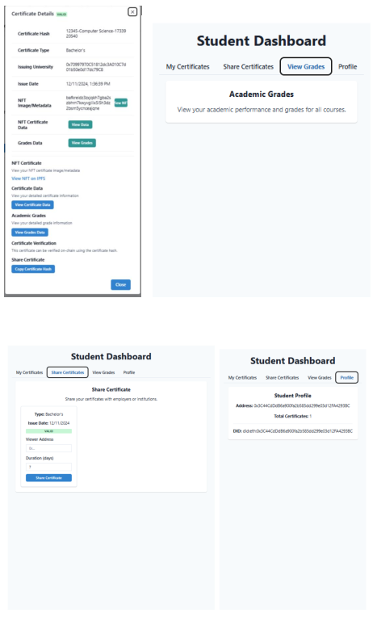
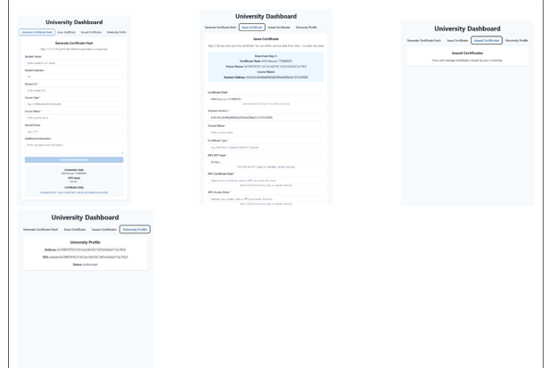
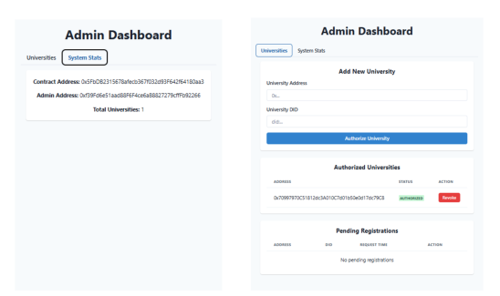

# 🎓 EDUCERTIFY
### Blockchain-Based Certification Management System

EDUCERTIFY is a blockchain-based certification management system designed to make academic credentials more secure, transparent, and easily verifiable. By leveraging Ethereum smart contracts, NFTs, and IPFS, the platform enables educational institutions to issue digital certificates, students to manage their credentials, and employers to verify academic qualifications.

The project was developed as part of a blockchain application development project under the BLOCCAI initiative.

## 📸 Screenshots





(screenshots/employer-dashboard2.png)



## ✨ Features

- **Digital Certificate Issuance** – Educational institutions can issue digital academic certificates represented as blockchain-based NFTs.
- **Certificate Verification** – Employers and other authorized parties can verify the authenticity of academic credentials through smart contracts.
- **Certificate Management** – Students can view and manage their issued certificates.
- **Credential Sharing** – Students can share their credentials with employers and other authorized parties.
- **Privacy-Aware Data Access** – Detailed academic information is stored off-chain using IPFS, while cryptographic hashes link the data to blockchain records.
- **University Authorization** – Administrators can manage and approve educational institutions authorized to issue certificates.
- **Certificate Revocation** – Certificates can be invalidated when necessary.
- **Access Control** – Smart contracts support authorization and time-limited access to private credential information.

## 👥 User Interfaces

The application provides separate interfaces for different stakeholders:

| Interface | Description |
|---|---|
| Student | View certificates, share credentials, access grades, and manage profile |
| University | Generate certificate hashes, issue certificates, and manage issued credentials |
| Employer / Verifier | View shared certificates and verify academic credentials |
| Administrator | Approve universities and monitor system statistics |

## 🏗️ Architecture

EDUCERTIFY combines blockchain technology with decentralized storage and a web-based application interface.

### On-Chain
- Solidity smart contracts
- ERC-721 certificate NFTs
- Certificate issuance and verification
- University authorization
- Certificate revocation
- Credential access management

### Off-Chain
- IPFS for storing detailed academic records
- Pinata for IPFS file management
- Web application frontend
- JavaScript APIs for interacting with smart contracts

## 🛠️ Tech Stack

| Technology | Purpose |
|---|---|
| Solidity | Smart contract development |
| Ethereum | Blockchain infrastructure |
| ERC-721 | NFT certificate representation |
| JavaScript | Application logic |
| HTML5 | Web application structure |
| CSS3 | User interface styling |
| Web3.js | Frontend-blockchain integration |
| IPFS | Decentralized file storage |
| Pinata | IPFS file management |
| MetaMask | Blockchain wallet integration |

## 📂 Smart Contracts

The system is designed around the following smart contracts:

- **EducationCertificate.sol** – Core certificate management, NFT issuance, university authorization, certificate revocation, and access control.
- **CertificateHelper.sol** – Helper functionality for certificate data processing.
- **CertificateVerifier.sol** – Certificate verification functionality.

## 🔐 Identity & Privacy

EDUCERTIFY incorporates Self-Sovereign Identity (SSI) principles to give users greater control over their academic credentials.

- Decentralized Identifiers (DIDs) for participant identification.
- Verifiable Credentials (VCs) for trusted academic qualifications.
- NFT-based credential representation.
- IPFS-based off-chain storage for detailed academic records.
- User-controlled credential sharing and authorization.

## 🚀 Getting Started

### Prerequisites

- Node.js and npm
- MetaMask
- Ethereum development environment
- IPFS / Pinata account

### Installation

```bash
# Clone the repository
git clone <repository-url>

# Navigate to the project directory
cd <project-directory>

# Install dependencies
npm install
```

### Configuration

Configure the required blockchain, wallet, and IPFS settings according to the project's environment configuration.

### Running the Application

Follow the project's deployment instructions to deploy the smart contracts and start the frontend application.

> Detailed setup and deployment instructions will be added as the project documentation is finalized.

## 🎥 Demo

[▶️ Watch the EDUCERTIFY Demo](demo/educertify-demo.mp4)

## 🎯 Project Objectives

EDUCERTIFY aims to address several challenges in traditional academic credential management:

- Certificate fraud and forgery
- Time-consuming manual verification
- Difficult cross-border credential recognition
- Limited control over personal academic information
- Inefficient credential issuance and management

## 🌍 Sustainable Development Goals

This project contributes to the following United Nations Sustainable Development Goals:

- **SDG 1 – No Poverty:** Improving access to international employment opportunities through verifiable qualifications.
- **SDG 8 – Decent Work and Economic Growth:** Reducing employment barriers through faster credential verification.
- **SDG 10 – Reduced Inequalities:** Promoting fairer access to opportunities regardless of geographical background.
- **SDG 16 – Peace, Justice and Strong Institutions:** Supporting transparency and trust through tamper-resistant academic records.

## 👨‍💻 Contributors

- Mohamad Hussen Chamsi
- Raphael Vincent Gabriel Dato
- Nadja Füzi
- Youssef Kandil

## 📌 Project Context

Academic blockchain application project developed as part of the BLOCCAI initiative.

